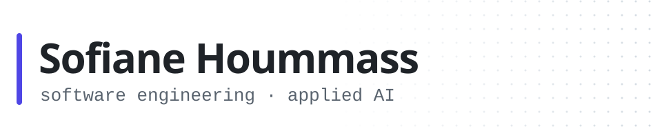

<picture>
	<source media="(prefers-color-scheme: dark)" srcset="assets/banner-dark.svg">
	
</picture>

 

Hi, I'm **Sofiane**, a software engineering student at an engineering school in Paris.

I focus on **AI and machine learning**, especially **LLMs**, **retrieval-augmented generation (RAG)** and **computer vision**. What interests me is the engineering around the model: getting good data in, measuring whether the output is right, and shipping it inside software that stays reliable, testable and affordable to run.

 

## 📭 Contact

	
	&nbsp;
	

 

<!-- ============================================================
  FEATURED PROJECTS (hidden for now): remove these comment markers
  to show the section again. Keep 1 to 3 projects, best first.
  To add a project, copy the "PROJECT BLOCK" template at the bottom
  of this file and paste it right below the heading. With more than
  3 featured projects, move the oldest one to "More projects".
  Nosite is hidden until the site works again.

## 📌 Featured

### [🗺️ Nosite](https://www.nosite.fr)

A web app that finds local businesses around an address with no website, or an outdated one, so web designers know who to contact first. It has accounts, a saved prospect list and paid plans (French interface).

Each site it finds gets a **freshness score from 0 to 100** built from seven weighted signals, from the `Last-Modified` header to JSON-LD dates and `<time>` tags. The checker resolves DNS before fetching and refuses private IP ranges, so it cannot be turned against internal networks, and when the Google Places circuit breaker trips, search falls back to OpenStreetMap.

	

**[Live](https://www.nosite.fr)** · Next.js, Express, TypeScript, PostgreSQL, Redis

 

============================================================= -->

<!-- ============================================================
  MORE PROJECTS (secondary section): keep it commented out until
  it holds at least one project, then remove the comment markers.

## 🗂️ More projects

* **[{emoji} {Project name}](https://github.com/sofianehms/{repo})**: {one sentence: what it does}. {Stack or year, optional.}

============================================================= -->

<!-- ============================================================
  PROJECT BLOCK TEMPLATE (copy everything between the two lines)
  - Title: links to the demo if there is one, otherwise to the repo.
  - Picture: optional. Store it in assets/ (1440 px wide, 2:1, JPEG
    for screenshots), always with a descriptive alt text. Delete the
    
 block if there is no real, readable visual.
  - Links: keep only the ones that exist (Live, Demo, Code, Write-up).
------------------------------------------------------------------

### [{emoji} {Project name}]({demo or repo URL})

{One or two sentences: what it lets someone do, and for whom.}

{One verifiable technical detail that makes people want to open the repo.}

	

**[Live]({demo URL})** · **[Code](https://github.com/sofianehms/{repo})** · {Main tools}

 

------------------------------------------------------------------
============================================================= -->
